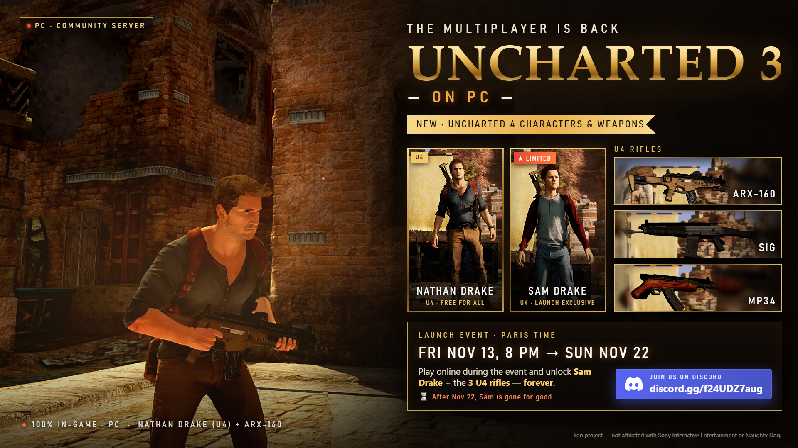
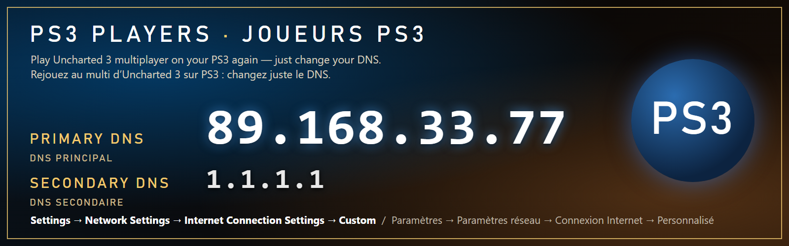
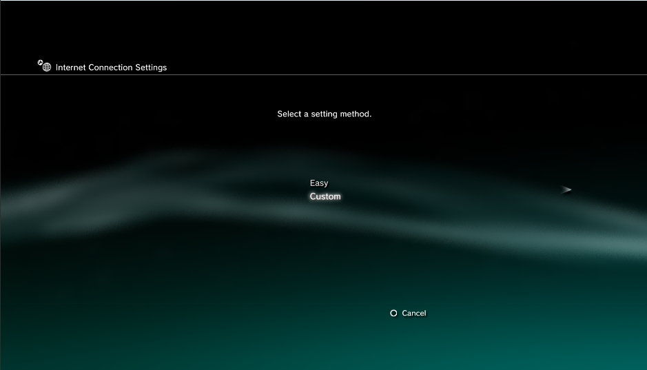
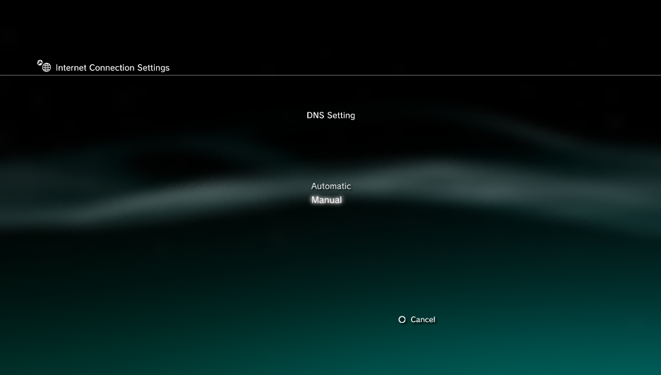
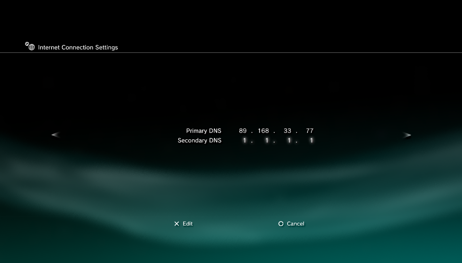
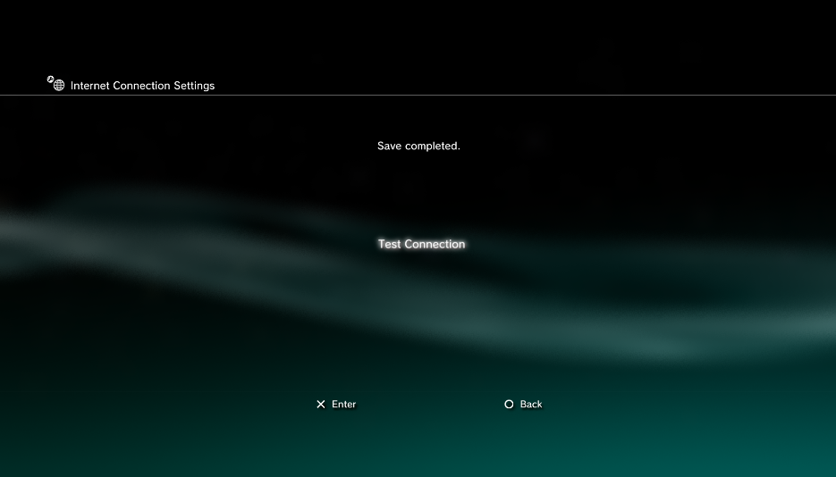

  

  
  &nbsp;
  
  &nbsp;
  

<b>🇬🇧 English below · 🇫🇷 Français plus bas</b>

---

## 🎮 PS3 PLAYERS · JOUEURS PS3

| | 🇬🇧 | 🇫🇷 |
|---|---|---|
| **Primary DNS** | **`89.168.33.77`** | **DNS principal : `89.168.33.77`** |
| **Secondary DNS** | `1.1.1.1` | DNS secondaire : `1.1.1.1` |

**🇬🇧 How to:** on your PS3, **Settings → Network Settings → Internet Connection Settings → Custom**. Keep your usual Wi-Fi or cable choice, set **DNS → Manual**, enter the two addresses above, then **Test Connection**. Start Uncharted 3 and go to **Multiplayer**. That's it.

**🇫🇷 Comment faire :** sur la PS3, **Paramètres → Paramètres réseau → Paramètres de connexion Internet → Personnalisé**. Gardez votre choix habituel (Wi-Fi ou câble), mettez **DNS → Manuel**, entrez les deux adresses ci-dessus, puis **Tester la connexion**. Lancez Uncharted 3 et allez dans **Multijoueur**. C'est tout.

     

> PS3 and PC play on separate servers: PS3 players meet PS3 players, PC players meet PC players.
> Les PS3 et les PC jouent sur des serveurs séparés : PS3 avec PS3, PC avec PC.

---

## 🇬🇧 English

### 🔥 Launch event — **Fri Nov 13, 8 PM → Sun Nov 22** (Paris time)

Play online during the event and unlock **Sam Drake (U4)** + the **ARX-160, SIG and MP34** — **forever**.
**Nathan Drake (U4)** is free for everyone. After Nov 22, **Sam is gone for good**.

### 🖥️ PC: what you need

- Windows 10 or 11 (64-bit).
- A graphics card with **Vulkan 1.3** and an up-to-date driver.
- **Your own copy** of the PS4 game *Uncharted: The Nathan Drake Collection* (**CUSA02320**) with its **1.02** update. No game file is included here.
- An Internet connection.

### 🖥️ PC: install

1. **[Download `Uncharted-Multiplayer-PC.zip`](https://github.com/Sasiraj123/Uncharted-Multiplayer-on-PC/releases/latest/download/Uncharted-Multiplayer-PC.zip)** and unzip it anywhere.
2. Run **`Uncharted Multiplayer.exe`**.
3. Show it your game folder, then pick your player name (it is yours for good: your progress is saved with it).
4. The first launch downloads the multiplayer data (about 3 GB, checked file by file).
   **The launcher updates itself**: each time you open it, it installs the latest version (your name and settings are kept).
5. **Play Online** — and come say hi on **[Discord](https://discord.gg/f24UDZ7aug)**.

### ✨ What's in it

- The Uncharted 3 multiplayer, its lobby and its network, ported from the PS3 version function by function.
- Multiplayer and co-op maps, characters, sounds and texts brought back into the game.
- Your profile (character, loadouts, purchases, rank, stats) saved on the server, like on PS3.
- **New:** Uncharted 4 characters and rifles, unlocked by events.
- Image fixes (shaders and scenery) made for this project, and our own lobby server.

---

## 🇫🇷 Français

### 🔥 Événement de lancement — **ven. 13 nov. 20 h → dim. 22 nov.** (heure de Paris)

Jouez en ligne pendant l'événement et débloquez **Sam Drake (U4)** + l'**ARX-160, le SIG et le MP34**, **pour toujours**.
**Nathan Drake (U4)** est libre pour tous. Après le 22 novembre, **Sam ne reviendra plus**.

### 🖥️ PC : ce qu'il faut

- Windows 10 ou 11 (64 bits).
- Une carte graphique **Vulkan 1.3**, avec un pilote à jour.
- **Votre propre copie** du jeu PS4 *Uncharted : The Nathan Drake Collection* (**CUSA02320**) et sa mise à jour **1.02**. Aucun fichier du jeu n'est inclus ici.
- Une connexion Internet.

### 🖥️ PC : installation

1. **[Téléchargez `Uncharted-Multiplayer-PC.zip`](https://github.com/Sasiraj123/Uncharted-Multiplayer-on-PC/releases/latest/download/Uncharted-Multiplayer-PC.zip)** et dézippez-le où vous voulez.
2. Lancez **`Uncharted Multiplayer.exe`**.
3. Montrez-lui le dossier du jeu, puis choisissez votre pseudo (il est à vous pour toujours : votre progression est enregistrée avec lui).
4. Le premier lancement télécharge les données du multi (environ 3 Go, vérifiées morceau par morceau).
   **Le lanceur se met à jour tout seul** : à chaque ouverture, il installe la dernière version (pseudo et réglages gardés).
5. **Jouer en ligne** — et passez dire bonjour sur **[Discord](https://discord.gg/f24UDZ7aug)**.

### ✨ Ce qu'il y a dedans

- Le multi d'Uncharted 3, son salon et son réseau, portés de la version PS3 fonction par fonction.
- Les cartes multi et coop, les persos, les sons et les textes remis dans le jeu.
- Votre profil (perso, paquetages, achats, rang, stats) enregistré sur le serveur, comme sur PS3.
- **Nouveau :** des persos et des fusils d'Uncharted 4, débloqués par des événements.
- Des correctifs d'image (shaders et décors) faits pour ce projet, et notre propre serveur de salon.

